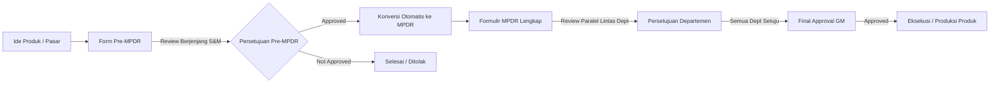
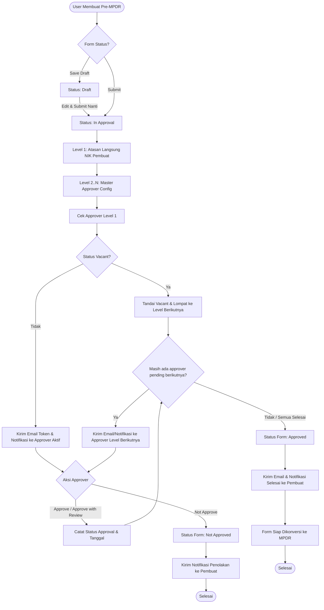
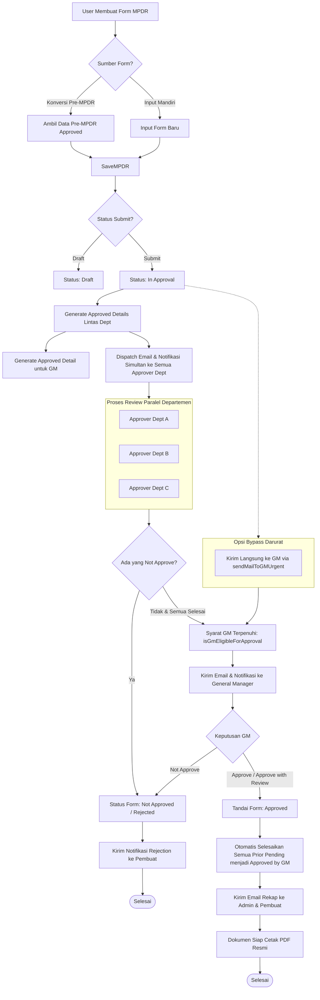
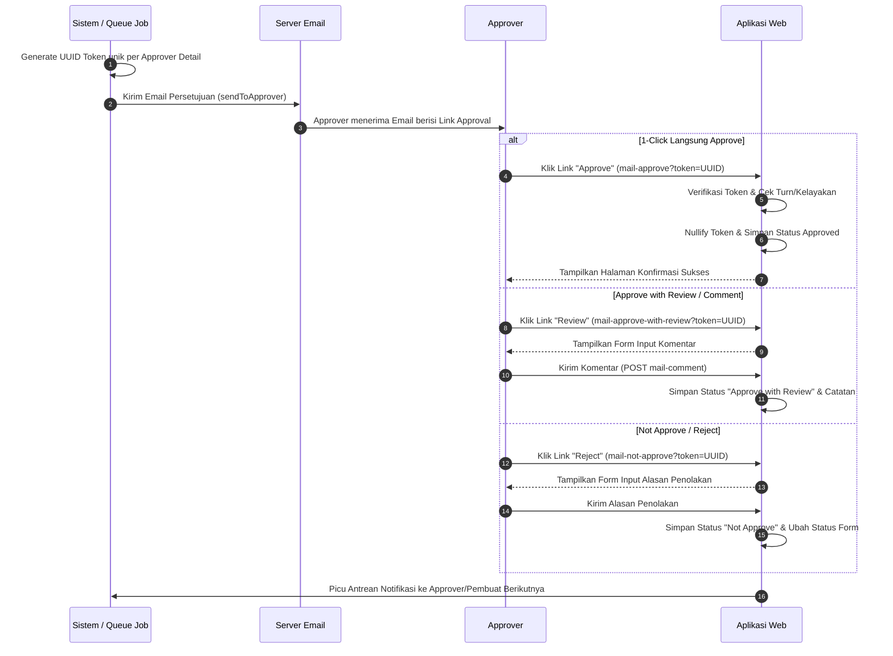

# Dokumentasi Alur Kerja Pre-MPDR & MPDR

Dokumen ini menjelaskan secara menyeluruh arsitektur, siklus hidup, alur persetujuan (*approval workflow*), mekanisme notifikasi/email, fitur darurat (*bypass*), serta struktur data untuk modul **Pre-MPDR** (*Preliminary Market Product Development Request*) dan **MPDR** (*Market Product Development Request*).

---

## Daftar Isi
1. [Ringkasan & Hubungan Pre-MPDR dan MPDR](#1-ringkasan--hubungan-pre-mpdr-dan-mpdr)
2. [Alur Bisnis & Siklus Hidup Pre-MPDR](#2-alur-bisnis--siklus-hidup-pre-mpdr)
   - [2.1 Pembuatan & Pengajuan](#21-pembuatan--pengajuan-pre-mpdr)
   - [2.2 Matriks & Hirarki Approval Sekuensial](#22-matriks--hirarki-approval-sekuensial)
   - [2.3 Diagram Alur Pre-MPDR (Mermaid)](#23-diagram-alur-pre-mpdr)
   - [2.4 Fitur Khusus Pre-MPDR (Vacant, Takeover, Direct to Last Approver)](#24-fitur-khusus-pre-mpdr)
3. [Alur Bisnis & Siklus Hidup MPDR](#3-alur-bisnis--siklus-hidup-mpdr)
   - [3.1 Pembuatan (Mandiri vs Konversi dari Pre-MPDR)](#31-pembuatan-mpdr)
   - [3.2 Matriks Approval Paralel Lintas Departemen & GM](#32-matriks-approval-paralel-lintas-departemen--gm)
   - [3.3 Diagram Alur MPDR (Mermaid)](#33-diagram-alur-mpdr)
   - [3.4 Fitur Khusus MPDR (Direct to GM, Auto-Approval by GM, Resend)](#34-fitur-khusus-mpdr)
4. [Mekanisme Persetujuan Melalui Email (Token-Based 1-Click)](#4-mekanisme-persetujuan-melalui-email)
5. [Tabel Model, Relasi, & Database Schema](#5-tabel-model-relasi--database-schema)
6. [Hak Akses & Role-Permission Matrix](#6-hak-akses--role-permission-matrix)
7. [Audit Trail & Notifikasi](#7-audit-trail--notifikasi)

---

## 1. Ringkasan & Hubungan Pre-MPDR dan MPDR

Dalam proses inovasi dan pengembangan produk di perusahaan:
1. **Pre-MPDR** berfungsi sebagai proposal penyaringan awal (*initial idea/screening*). Tim Sales/Marketing mengusulkan konsep awal produk baru atau perbaikan formulasi/kemasan untuk dinilai kelayakannya oleh atasan dan jajaran manajemen Sales & Marketing.
2. **MPDR** adalah dokumen spesifikasi teknis dan komersial formal berskala penuh. Setelah Pre-MPDR berstatus **Approved**, formulir tersebut dapat ditarik (*convert*) menjadi MPDR. Data teknis yang sudah diisi di Pre-MPDR otomatis terisi (*auto-populate*), lalu diajukan ke tim lintas fungsi: Finance, R&D, QC/QA, Manufacturing/Plant, hingga persetujuan akhir oleh General Manager (GM).

---

## 2. Alur Bisnis & Siklus Hidup Pre-MPDR

### 2.1 Pembuatan & Pengajuan Pre-MPDR
1. **Inisiasi Nomor Registrasi**: Format otomatis tahunan `{YY}PREMPDR{0000}` (contoh: `26PREMPDR0001`).
2. **Pengisian Form**:
   - Informasi Proyek: Nama Proyek, Nama Brand, Level Prioritas (*Low, Medium, High*).
   - Rincian Teknis & Pasar: *Rational for development*, estimasi target peluncuran, kategori produk, saluran distribusi (*channel* lokal/internasional), deskripsi produk, suhu simpan & kirim, sertifikasi (*Halal, BPOM, dsb.*), data produk kompetitor (*nama, ukuran, kemasan, harga*), spesifikasi kemasan, serta estimasi volume & margin pasar.
3. **Pilihan Status Simpan**:
   - **Draft**: Disimpan lokal tanpa memicu alur approval. Form dapat diedit/dihapus sewaktu-waktu oleh pembuat.
   - **Submit**: Mengubah status form menjadi `In Approval` dan mengunci form dari perubahan langsung oleh pembuat.

### 2.2 Matriks & Hirarki Approval Sekuensial
Alur persetujuan Pre-MPDR bersifat **Sekuensial / Bertingkat (Level 1 $\rightarrow$ Level 2 $\rightarrow$ ... $\rightarrow$ Level N)**:
- **Level 1**: Selalu merupakan **Atasan Langsung (Supervisor)** dari pembuat form, yang ditentukan dari kolom `users.atasan_nik`.
- **Level 2 dst**: Diambil dari konfigurasi master approver di tabel `pre_mpdr_approvers` yang terdaftar untuk NIK user pembuat (atau konfigurasi default).
- Urutan approval mengikuti nilai kolom `level` terkecil ke terbesar.
- Hanya approver pada giliran aktif yang dapat mengambil tindakan persetujuan.

### 2.3 Diagram Alur Pre-MPDR

### 2.4 Fitur Khusus Pre-MPDR
1. **Skipping Posisi Vacant**:
   - Jika atasan atau approver memiliki status `Vacant` di master posisi/user, sistem secara otomatis menandai baris approval tersebut sebagai `Vacant` dan mengarahkan antrean approval ke approver aktif berikutnya.
   - Ketika approver berikutnya melakukan approval, sistem secara otomatis mengeksekusi method `handlePriorVacantAndPendingApprovers()` untuk merapikan level-level pending/vacant di bawahnya.
2. **Super-Admin Takeover**:
   - Pengguna dengan role `super-admin` dapat mengambil alih persetujuan atas nama approver yang sedang pending jika approver bersangkutan berhalangan.
   - Tindakan ini dicatat secara transparan di tabel `activity_log` (*"by Super Admin on behalf of Approver"*).
3. **Direct to Last Approver (Urgent Bypass)**:
   - Jika form berstatus mendesak dan belum ada approver yang menolak (*not approve*), tombol atau aksi kirim langsung ke approver tingkat tertinggi (*misal: Head of Sales & Marketing*) dapat dipicu.
   - Kolom `last_approver_direct_approval` ditandai bernilai `true`, dan token langsung diaktifkan untuk level terakhir.

---

## 3. Alur Bisnis & Siklus Hidup MPDR

### 3.1 Pembuatan MPDR
Pembuatan MPDR memiliki dua metode:
1. **Konversi dari Pre-MPDR**:
   - Pembuat memilih nomor Pre-MPDR yang berstatus `Approved` dari dropdown list (`get-prempdr-list`).
   - Seluruh detail produk, kategori, kemasan, sertifikasi, kompetitor, dan estimasi pasar otomatis diimpor (`getpremprdtompdr`).
   - Nilai nomor Pre-MPDR disimpan di kolom `mpdr_forms.prempdr_no`.
2. **Pembuatan Mandiri (Baru)**:
   - Pembuat menginput data lengkap tanpa referensi Pre-MPDR sebelumnya.
   - Nomor registrasi tahunan otomatis dibuat dengan format `{YY}MPDR{0000}` (contoh: `26MPDR0001`).

### 3.2 Matriks Approval Paralel Lintas Departemen & GM
Berbeda dengan Pre-MPDR yang berurutan per level, approval MPDR menggabungkan **Approval Paralel Antar-Departemen** dengan **Gerbang Akhir General Manager**:

1. **Approver Departemen (Paralel)**:
   - Approver yang tercatat di tabel `mpdr_approvers` (mewakili Finance, R&D, QC, Manufacturing, Sales & Marketing, dsb.) menerima notifikasi dan email persetujuan secara serentak (*simultan*).
   - Masing-masing approver departemen dapat melakukan `Approve`, `Approve with Review`, atau `Not Approve` secara mandiri tanpa harus menunggu departemen lain selesai.
2. **Persetujuan Akhir oleh General Manager (GM)**:
   - Posisi GM selalu dimasukkan ke dalam daftar approval form.
   - **Aturan Kelayakan GM**: GM baru memenuhi syarat approval (`isGmEligibleForApproval()`) apabila **seluruh approver departemen telah memberikan persetujuan** dan tidak ada satupun yang menolak.
   - Email/antrean approval ke GM baru dikirimkan setelah syarat kelayakan tersebut terpenuhi.

### 3.3 Diagram Alur MPDR

### 3.4 Fitur Khusus MPDR
1. **Send Urgent Direct to GM**:
   - Jika dokumen memerlukan persetujuan mendesak, pengguna yang berwenang dapat memicu rute darurat `sendMailToGMUrgent`.
   - Syarat: Form sedang `In Approval` dan belum ada satupun approver yang menolak.
   - GM langsung menerima token dan email darurat untuk memutuskan form tanpa harus menunggu approver departemen lainnya selesai.
2. **Auto-Resolution oleh GM**:
   - Saat General Manager melakukan persetujuan (baik normal maupun bypass), seluruh approver departemen yang statusnya masih `pending` atau `vacant` secara otomatis diubah menjadi `approve with review` dengan keterangan *"Approved by GM"*.
3. **Resend Email Approval**:
   - Jika link email approver kedaluwarsa atau hilang, admin/pembuat berizin `view resend mpdr` dapat mengirim ulang email dengan token baru melalui route `resend-email/{no_reg}`.
4. **Cetak PDF Formal**:
   - Rute `/mpdr/print/{no_reg}` memformat seluruh data form dan matriks tanda tangan digital (*nama approver, tanggal approval, status*) ke dalam dokumen PDF standar perusahaan.

---

## 4. Mekanisme Persetujuan Melalui Email

Sistem menyediakan fitur persetujuan tanpa perlu login ke sistem melalui tautan email token:

---

## 5. Tabel Model, Relasi, & Database Schema

### 5.1 Modul Pre-MPDR
| Tabel | Model Eloquent | Fungsi Utama |
|---|---|---|
| `pre_mpdr_forms` | `PreMpdrForm` | Header form: nomor, user pembuat, nama proyek, brand, prioritas, status, route_to. |
| `pre_mpdr_form_details` | `PreMpdrFormDetail` | Alasan pengembangan (*rational for development*) dan target rilis. |
| `pre_mpdr_product_categories` | `PreMpdrProductCategory` | Kategori produk (*Industrial, Consumer, Bakery, dsb.*). |
| `pre_mpdr_channels` | `PreMpdrChannel` | Saluran distribusi (*Modern Trade, Traditional, Export/International*). |
| `pre_mpdr_product_descriptions` | `PreMpdrProductDescription` | Deskripsi karakteristik produk, cara pakai, suhu penyimpanan/kirim. |
| `pre_mpdr_certification_requirements` | `PreMpdrCertificationRequirement` | Standar sertifikasi yang dibutuhkan (*Halal, BPOM, SNI, dsb.*). |
| `pre_mpdr_competitor_products` | `PreMpdrCompetitorProduct` | Daftar produk saingan di pasar beserta ukuran, kemasan, dan harga. |
| `pre_mpdr_detailed_packagings` | `PreMpdrDetailedPackaging` | Spesifikasi kemasan (*Carton, Pouch, Pail, dsb.*) dan berat. |
| `pre_mpdr_market_updates` | `PreMpdrMarketUpdate` | Potensi volume tahunan, target margin, estimasi harga jual. |
| `pre_mpdr_approved_details` | `PreMpdrApprovedDetail` | Matriks approval per form: approver NIK, level, status, tanggal, token UUID, komentar. |
| `pre_mpdr_approvers` | `PreMpdrApprover` | Master konfigurasi urutan approver per user NIK. |
| `pre_mpdr_revisions` | `PreMpdrRevision` | Versi revisi dokumen/template. |

### 5.2 Modul MPDR
| Tabel | Model Eloquent | Fungsi Utama |
|---|---|---|
| `mpdr_forms` | `MpdrForm` | Header form MPDR: nomor, prempdr_no (opsional), pembuat, requester, status, prioritas. |
| `mpdr_form_details` | `MpdrFormDetail` | Data rincian teknis pengembangan produk. |
| `mpdr_product_categories` | `MpdrProductCategory` | Kategori produk. |
| `mpdr_channels` | `MpdrChannel` | Saluran distribusi. |
| `mpdr_product_descriptions` | `MpdrProductDescription` | Deskripsi produk & spesifikasi penyimpanan. |
| `mpdr_certification_requirements` | `MpdrCertificationRequirement` | Kebutuhan sertifikasi. |
| `mpdr_competitor_products` | `MpdrCompetitorProduct` | Produk kompetitor & benchmarking harga. |
| `mpdr_detailed_packagings` | `MpdrDetailedPackaging` | Rincian kemasan & variasi kemasan. |
| `mpdr_market_updates` | `MpdrMarketUpdate` | Rincian komersial & volume pasar. |
| `mpdr_approved_details` | `MpdrApprovedDetail` | Matriks approval per form untuk seluruh departemen & General Manager. |
| `mpdr_initiator_approved_details` | `MpdrInitiatorApprovedDetail` | Data inisiasi dan review awal inisiator. |
| `mpdr_approvers` | `MpdrApprover` | Master konfigurasi approver MPDR per user NIK. |
| `mpdr_revisions` | `MpdrRevision` | Riwayat versi template MPDR. |

---

## 6. Hak Akses & Role-Permission Matrix

Berikut pemetaan hak akses fungsional (*permissions*) yang digunakan pada kedua modul:

| Permission | Pre-MPDR | MPDR | Keterangan Akses |
|---|:---:|:---:|---|
| `view pre` | ✓ | - | Melihat menu dan daftar Pre-MPDR di navigasi & dashboard. |
| `view create pre` | ✓ | - | Menampilkan tombol dan formulir tambah Pre-MPDR baru. |
| `view edit pre` | ✓ | - | Mengubah form Pre-MPDR yang masih berstatus Draft/In Approval. |
| `view delete pre` | ✓ | - | Menghapus draft form Pre-MPDR. |
| `view approval pre` | ✓ | - | Mengakses halaman antrean approval Pre-MPDR. |
| `view approver pre` | ✓ | - | Mengatur master approver Pre-MPDR. |
| `view resend pre` | ✓ | - | Menjalankan tombol kirim ulang email approval Pre-MPDR. |
| `view direct head snm pre` | ✓ | - | Menjalankan bypass darurat langsung ke Head of Sales & Marketing. |
| `view mpdr` | - | ✓ | Melihat menu dan daftar MPDR di navigasi & dashboard. |
| `view create mpdr` | - | ✓ | Menampilkan tombol dan formulir pengajuan MPDR baru. |
| `view edit mpdr` | - | ✓ | Mengubah data formulir MPDR. |
| `view delete mpdr` | - | ✓ | Menghapus data formulir MPDR. |
| `view approval mpdr` | - | ✓ | Mengakses halaman antrean approval MPDR. |
| `view approver mpdr` | - | ✓ | Mengatur master konfigurasi approver MPDR. |
| `view resend mpdr` | - | ✓ | Mengirim ulang email approval MPDR. |
| `view direct gm mpdr` | - | ✓ | Menjalankan aksi bypass darurat langsung ke General Manager. |

---

## 7. Audit Trail & Notifikasi

1. **Spatie Activity Log**:
   - Seluruh event tersimpan di log terpisah: log `prempdr` untuk modul Pre-MPDR dan log `mpdr` untuk modul MPDR.
   - Properti yang dicatat mencakup: *Nomor Form, Aksi, Tanggal, User Eksekutor, serta Keterangan Takeover/Bypass*.
2. **Notifikasi Aplikasi Web (Real-time bell notification)**:
   - Notifikasi dikirim menggunakan class `App\Notifications\MpdrNotification`.
   - Kategori tipe notifikasi:
     - `approval_request`: Approver menerima pemberitahuan bahwa terdapat dokumen yang menunggu giliran persetujuannya.
     - `approved`: Pembuat menerima pemberitahuan saat dokumen telah disetujui penuh.
     - `rejected`: Pembuat menerima pemberitahuan saat dokumen ditolak.
     - `updates`: Siaran pembaruan status ke pengguna terkait.
3. **Email Queue Notification**:
   - Pengiriman email diproses melalui background queue job (`ProcessApproval`, `sendResultToUser`, `sendUpdateToAdmin`) dengan delay proteksi lonjakan transaksi (2-10 detik) agar alur kerja pengguna di peramban tetap responsif.
